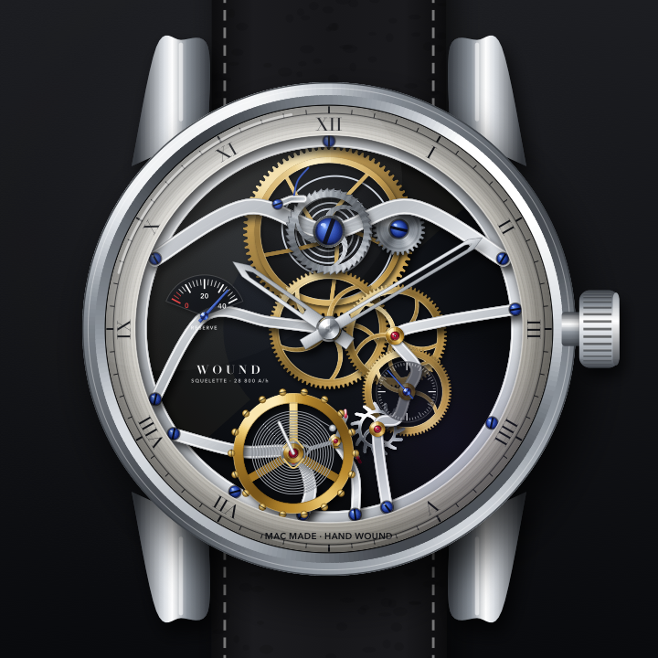
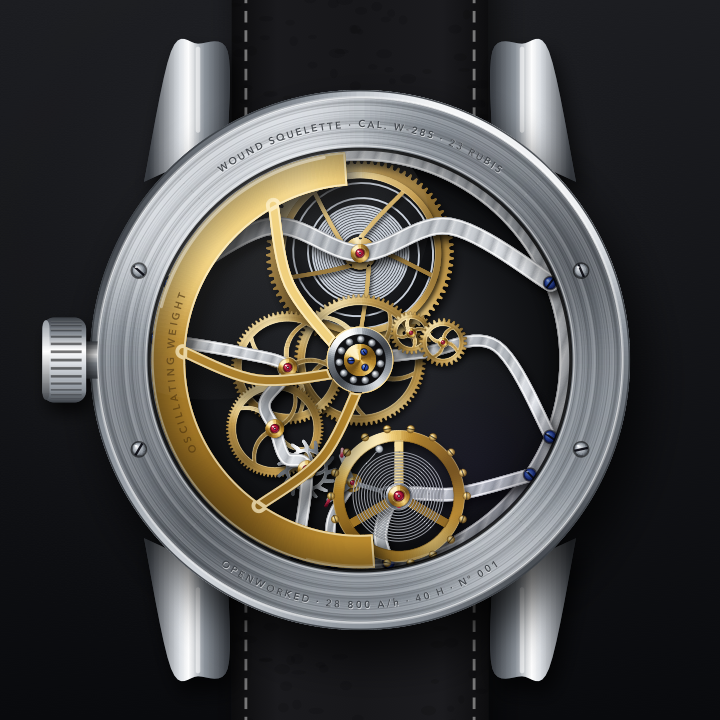
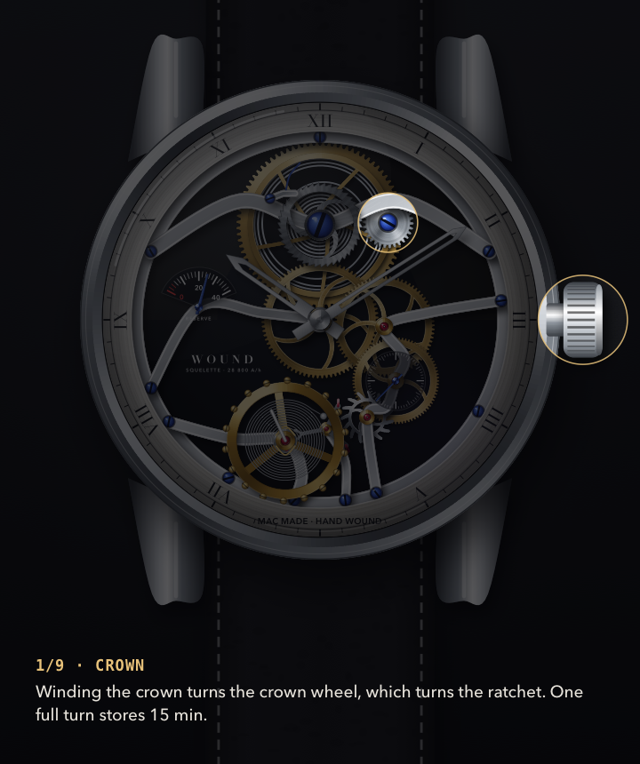
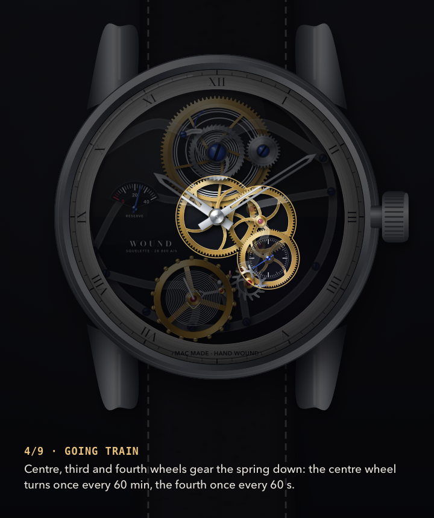
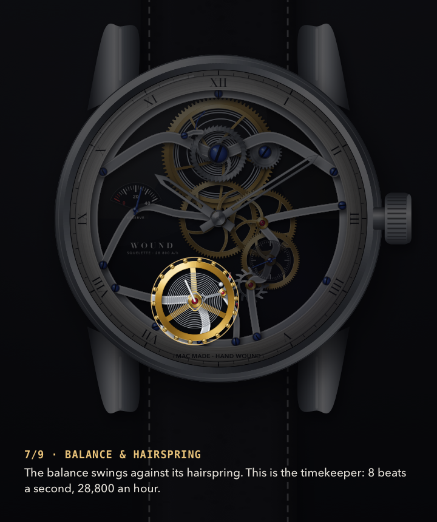
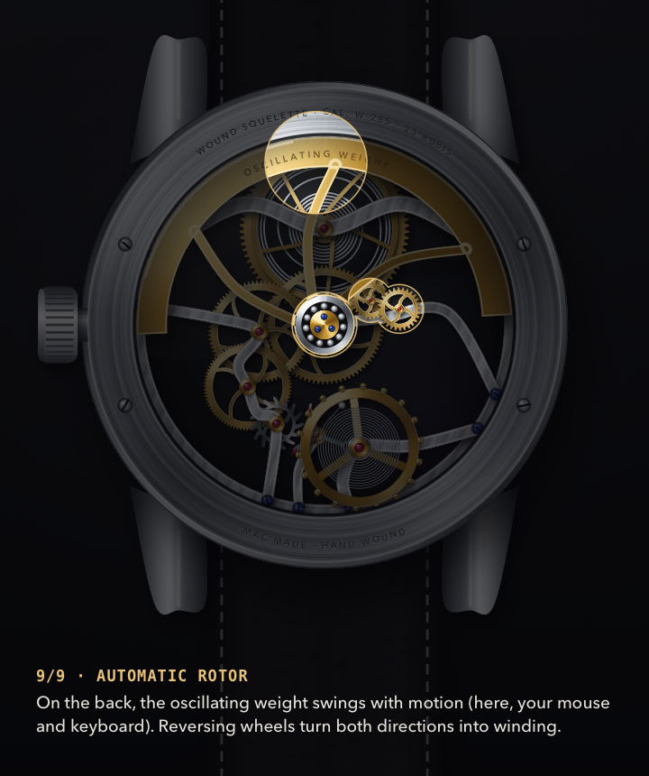

# Wound

> An interactive mechanical watch for macOS that you have to wind. On purpose.

Wound is a small, open-source macOS mechanical watch that is inconvenient by design.
Its 40-hour power reserve drains in real time, so the watch stops when you neglect it.
Scroll over its crown or drag upward to wind it again.
Your everyday mouse and keyboard activity also gives its automatic rotor a little energy.

The watch face is a skeleton Cal. W-28S drawn in Core Graphics, with an escapement, balance wheel, hairspring, train, exposed barrel, ratchet click, and a flip-to-caseback automatic rotor.





## Install

Wound needs macOS 14 or later and runs on Apple silicon and Intel Macs.

With Homebrew:

```sh
brew install --cask s3onghyun/tap/wound
```

Or download `Wound-0.1.0-macos-universal.zip` from the [latest release](https://github.com/s3onghyun/wound/releases/latest), unzip it, and move `Wound.app` to Applications.
The app is ad-hoc signed but not notarized.
On macOS 15 or later, open it once, then choose **Open Anyway** in System Settings -> Privacy & Security.
On macOS 13-14, Control-click the app and choose **Open**.

## Run from source

Wound needs macOS 14 or later and the Swift toolchain that ships with Xcode or Command Line Tools.

```sh
swift run
```

Use the menu-bar extra to check the reserve without opening the floating window.
The Settings window has sound, always-on-top, automatic winding, and accelerated demo-speed controls.
Sound is off by default.

## Interaction

- Scroll over the crown at 3 o'clock to wind it, one ratchet click at a time.
- Drag upward over that same crown if a mouse wheel is not available.
- Flip to the caseback to see the rotor react to automatic winding.
- Let it run out, then wind it back to life.

Winding is intentionally capped at 40 hours.
Past full reserve the crown gives visual resistance instead of adding more energy.
Reserve and the displayed time are saved in `UserDefaults`, so draining continues while Wound is closed.

## Explain the movement

Press **Explain** to walk the power path one part at a time:
crown → ratchet & click → mainspring barrel → going train → escape wheel → pallet fork → balance & hairspring → hands, then the automatic rotor on the caseback.
Use ← and → (or the chevrons) to move between stations.

- The lit part is the real drawing. Everything else dims, so there are no arrows or floating labels.
- The train runs at 1/20 speed while you explain, so you can see each beat lock and release the escape wheel. The reserve and the displayed time stay in real time.
- **Lift bridges** raises the bridges off the plate and makes them translucent, so you can see the wheels underneath.
- Every number in a caption, such as wheel speeds, the reserve, beats per hour, or the reserve one crown turn adds, is computed from the same movement model that drives the drawing.

The mode follows the [Anatomy](https://github.com/wheresryan22/anatomy) Claude skill, an October 2026 viral hit for explaining an idea by building it as a working object.
Its rule is "the object is the explanation."
The Anatomy skill itself is not used. Wound's version is plain Core Graphics in `Sources/Wound/Art/Explain.swift`.






[29-second explain reel](demo/wound-explain.mp4), rendered with:

```sh
swift run Wound --render-explain demo/explain-frames
ffmpeg -framerate 10 -i demo/explain-frames/frame-%04d.png -c:v libx264 -pix_fmt yuv420p demo/wound-explain.mp4
```

The reel runs the train at 1/5 speed so that each 3-second station shows some motion.

## Tests

```sh
swift test
```

With only the Command Line Tools installed and no Xcode, point the compiler at the bundled Testing framework:

```sh
F=/Library/Developer/CommandLineTools/Library/Developer/Frameworks
swift test -Xswiftc -F$F -Xlinker -F$F -Xlinker -rpath -Xlinker $F
```

`swift run Wound --self-test` still runs the movement checks without any test framework.

The dependency-free Swift movement checks cover reserve drain, stopped-time behavior, winding saturation, automatic-winding saturation, and persistence encoding.

## Demo

The [24-second movement demo](https://github.com/s3onghyun/wound/releases/latest/download/wound-demo.mp4) starts unwound, is crown-wound, runs, and then shows the automatic rotor.

To render it from source:

```sh
swift run Wound --render-demo demo/frames
ffmpeg -framerate 10 -i demo/frames/frame-%04d.png -c:v libx264 -pix_fmt yuv420p demo/wound-demo.mp4
```

The renderer makes a 24-second standalone movement reel: unwound, crown-wound, running, then caseback rotor.

## License

MIT.
The mechanical illustration is code in `Sources/Wound/Art`, not third-party artwork.
